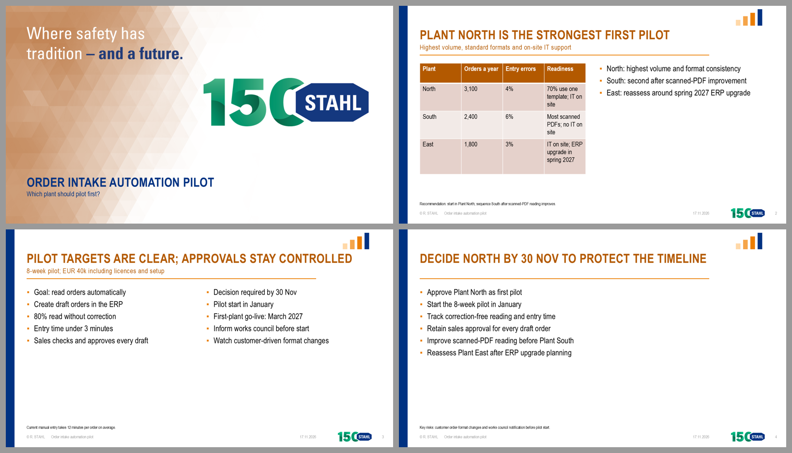
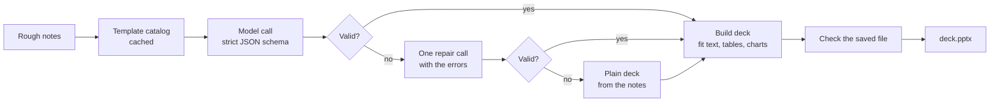

# slidegen

Turn rough notes into a PowerPoint deck of at most 4 slides on the company template: one
structured LLM call, validated output, text that always fits its box.

**About 4 seconds and under 1 cent per deck**, one model call (two when a repair is needed),
against about a minute when an LLM writes and runs a Python script for every deck.



[`samples/pilot.pptx`](samples/pilot.pptx), made in one call from the 20 lines of rough notes in
[`samples/pilot_notes.txt`](samples/pilot_notes.txt) on the finance template. The model chose
the layouts, put the plant comparison in a native table, and kept the Master's footer, date and
slide number. More samples: [`framework.pptx`](samples/framework.pptx) (company Master) and
[`framework_engineering.pptx`](samples/framework_engineering.pptx).

## Quick start

Python 3.12+ and [uv](https://docs.astral.sh/uv/). Put the key in the environment or in a
git-ignored `.env` file as `OPENROUTER_API_KEY=...`; it is never printed or logged.

```bash
uv sync
uv run python -m slidegen "rough notes..." --out deck.pptx --verbose
cat notes.txt | uv run python -m slidegen                  # notes from stdin
uv run python -m slidegen "notes" --mock repair --verbose  # no key, no network
```

| Option | Meaning |
|---|---|
| `--out` | output file (default `deck.pptx`) |
| `--model` | OpenRouter model id (default `openai/gpt-5.6-terra`) |
| `--team` | `base` (the company Master), `marketing`, `engineering`, `finance`, or `auto` |
| `--template` | any other .pptx |
| `--verbose` | outcome, tokens, cost, latency, warnings |
| `--mock` | canned answers: `ok`, `repair` (bad first answer), `fallback` (only bad answers) |

Exit codes: 0 OK, 1 the saved file has problems, 2 empty notes or bad arguments, 3 API key
missing or rejected.

## How it works



1. **Read the template** (`template.py`). Each layout becomes one catalog line with a budget per
   box, measured from the box size and the template's font. The Master's 35 layouts give 9
   distinct ones, about 260 tokens, cached by the file's hash. The model never sees XML:
   ```
   L1 Titel und Inhalt: title<=51, subtitle?<=120 "Optional Subheadline", body<=11x85, head?<=171 "Optional: Sources and/or captions"
   ```
   `11x85` = 11 bullets of 85 characters, `?` = optional, quoted = the template's own hint.
2. **One model call** (`prompts.py`, `llm.py`). Rules plus catalog, the notes inside `<notes>`
   tags, a strict JSON schema, temperature 0.2. Timeouts, 429 and 5xx are retried 3 times
   (1, 2, 4 s); a rejected key stops at once.
3. **Validate** (`schema.py`). Pydantic checks types and 1 to 4 slides, then every slide is
   checked against its layout: required slots, length limits, and every number in a table or
   chart must appear in the notes. All errors are returned at once.
4. **Repair once, then fall back** (`pipeline.py`). One repair call with the exact errors, never
   a loop. If it fails too, or the API is down, a plain deck is built from the notes. A bad key
   is the only case that stops, because only the user can fix it.
5. **Build and check** (`fit.py`, `deck.py`). Text is measured with the real font and shrinks a
   point at a time to a floor (60% of the template size, never under 12 pt); only then are
   words cut with "…". Tables and charts are native. Footer, date and slide number come from
   the layout. The saved file is re-opened and checked: slide count, empty boxes, overflow.

## Design choices

- **Content, not code.** The model writes JSON; tested Python builds the deck. Faster, cheaper,
  and nothing generated is executed.
- **Two limits per text.** Over the budget the font shrinks; only over twice the budget is it
  an error that triggers the repair. Fewer calls, no overflow.
- **Precise errors** ("4 columns and 9 rows; use 2 to 6 columns and 1 to 8 rows"), so one
  repair is enough.
- **No autofit.** PowerPoint only recalculates it when someone edits the slide, so the size is
  computed and written on every run. Text wraps at 95% of the width, because PowerPoint lays
  text out slightly wider than Pillow measures.
- **Tables and charts.** A table (several options × several figures, up to 8 rows × 6 columns)
  takes the first bullet box's place; a bar chart (one figure across items, up to 8 categories
  and 3 series) goes into the layout's chart box. Bars start at zero.
- **Prompt injection.** Tags inside the notes are escaped so they can't close the block, the
  answer must still pass validation, and nothing the model returns is executed.

## Templates

The company Master (`slidegen/templates/master.pptx`) is the default and stays unchanged. The
team templates are the Master in another colour, built by `scripts/build_templates.py`: same
layouts and boxes, so the tool works the same with all of them and a wrong pick only changes
the look. `--team auto` picks one from keywords in the notes (English, French, German) and
uses the Master when the signal is weak.

| Template | Look |
|---|---|
| base | the Master: green-to-teal mosaic, navy titles |
| marketing | raspberry mosaic and titles, orange accents |
| engineering | blue mosaic, dark slides with a blueprint grid, cyan titles |
| finance | amber mosaic and titles, navy side rail |

```bash
uv run python scripts/build_templates.py            # rebuild the team templates
uv run python scripts/build_showcase.py             # demo slides per template
uv run python scripts/render.py out/showcase/*.pptx # PNG previews via PowerPoint (Windows)
```

## Model choice

Chosen with [`notebooks/evaluate.ipynb`](notebooks/evaluate.ipynb): 8 notes × 2 runs per model,
scored blind by Claude Opus 5.5, twice (the two scorings differ by 0.11 on average).

| Model | First try | Quality (1-5) | Cost per deck | Latency |
|---|---|---|---|---|
| **GPT-5.6 Terra** (default) | 100% | 3.83 | $0.003 | 3.0 s |
| Claude Sonnet 5.5 | 94% | 3.58 | $0.011 | 4.6 s |

Qwen 3.8 Max's requests failed in this setup, so it fell back every time. Findings and next
steps are in [`NOTE.md`](NOTE.md); the demo script is in [`DEMO.md`](DEMO.md).

## Repository

| Path | What it does |
|---|---|
| `slidegen/__main__.py` | command line and exit codes |
| `slidegen/pipeline.py` | one run: call, repair, fallback, build, check |
| `slidegen/template.py` | template → cached catalog; team choice |
| `slidegen/prompts.py` | system prompt, notes wrapping, repair prompt |
| `slidegen/llm.py` | OpenRouter client with retries and usage; mock client |
| `slidegen/schema.py` | JSON schema sent to the model; validation |
| `slidegen/fit.py` | real-font measuring and shrinking |
| `slidegen/deck.py` | builds the .pptx, checks the saved file |
| `scripts/`, `notebooks/`, `samples/` | template builder and previews, evaluation, sample decks |

## Development

```bash
uv run ruff check . && uv run ruff format --check . && uv run pytest
```

Tests run offline: a fixture removes the API key and blocks the network. CI runs ruff, the
tests and a gitleaks secret scan on every push.
